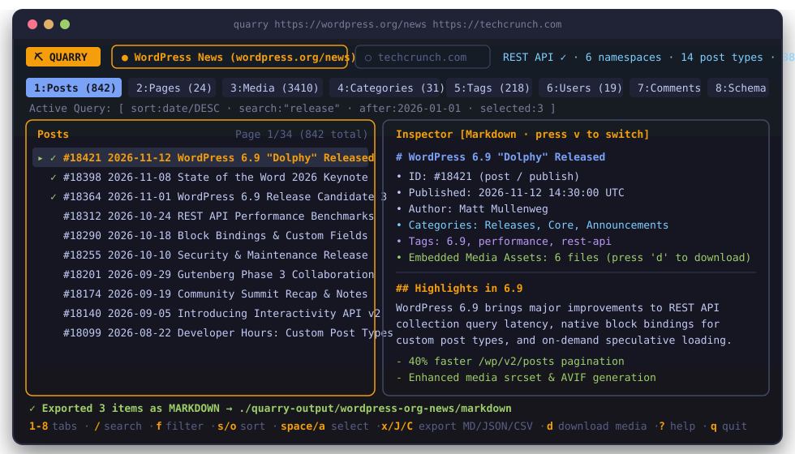
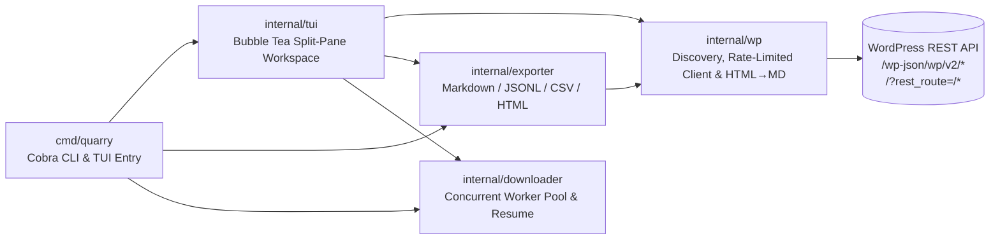

<p align="center">
  
</p>

<h1 align="center">quarry</h1>

<p align="center">
  <b>Excavate, explore, search, and mass-extract structured content &amp; media from any WordPress site via its REST API.</b><br>
  Interactive split-pane Terminal UI (TUI) + scriptable non-interactive CLI in a single static Go binary.
</p>

<p align="center">
  <a href="https://github.com/AryanHamedani/quarry/actions/workflows/ci.yml"></a>
  <a href="https://github.com/AryanHamedani/quarry/releases"></a>
  <a href="https://pkg.go.dev/github.com/AryanHamedani/quarry"></a>
  <a href="LICENSE"></a>
  
</p>

<p align="center">
  <a href="#features">Features</a> ·
  <a href="#install">Install</a> ·
  <a href="#quick-start">Quick Start</a> ·
  <a href="#interactive-tui">Interactive TUI</a> ·
  <a href="#cli-reference">CLI Reference</a> ·
  <a href="#architecture">Architecture</a>
</p>

<p align="center">
  
</p>

---

WordPress powers over 40% of the web and exposes a rich, structured JSON API under `/wp-json/wp/v2/` (or `/?rest_route=/`). Yet exploring a site's public data, filtering posts across taxonomies, converting Gutenberg HTML into clean Markdown, or bulk-archiving high-resolution media typically requires stitching together brittle scripts.

**Quarry** turns any WordPress site—or a list of dozens of sites—into a fast, searchable local workspace. Launch it with a URL for a full-featured **Terminal UI**, or run `quarry query`, `quarry export`, and `quarry media` in headless pipelines.

## Features

- **Resilient REST API Auto-Discovery** — Automatically probes `/wp-json/`, falls back to `/?rest_route=/` when pretty permalinks are disabled, and inspects HTTP `Link: <...>; rel="https://api.w.org/"` headers and HTML `<link>` tags.
- **Full WordPress Entity Coverage** — Browse and extract **Posts**, **Pages**, **Media Library**, **Categories**, **Tags**, **Users/Authors**, **Comments**, and dynamically discovered **Custom Post Types (CPTs)** & custom taxonomies.
- **Interactive Split-Pane TUI** — Built with [Bubble Tea](https://github.com/charmbracelet/bubbletea) and [Lip Gloss](https://github.com/charmbracelet/lipgloss):
  - Multi-site workspace switcher (`S`) when given multiple URLs or `--sites-file`.
  - Real-time full-text search (`/`), advanced filter DSL (`f`), and sort/direction cycling (`s` / `o`).
  - Relational drill-down: press `Enter` on any **Category**, **Tag**, or **Author** to immediately filter posts by that relation.
  - Live Content Inspector with instant toggling (`v`) between **clean Markdown**, **Raw HTML**, and **REST JSON**.
- **Multi-Format Data Extraction** — Export single items, multi-selections, or entire sites into:
  - **Markdown (`.md`)** with structured **YAML frontmatter** (`id`, `title`, `slug`, `date`, `author`, `categories`, `tags`, `featured_image`, `canonical_url`).
  - **JSON** & streaming **JSON Lines (`.jsonl`)** for LLM/RAG pipelines and data warehouses.
  - **CSV** for spreadsheets and analytics.
  - **Self-contained HTML5** documents for offline reading.
- **Concurrent Media Downloader Pool** — Bounded worker pool that downloads original high-resolution attachments from `/wp/v2/media` *and* inline ``/`<video>`/`<audio>` assets embedded inside post HTML, with SHA-256 hashing, `wp-content/uploads/YYYY/MM/` directory preservation, and automatic resume/deduplication.

---

## Install

### Using `go install`

```bash
go install github.com/AryanHamedani/quarry/cmd/quarry@latest
```

### Build from source

```bash
git clone https://github.com/AryanHamedani/quarry.git
cd quarry
go build -o quarry ./cmd/quarry
sudo install -m 755 quarry /usr/local/bin/quarry
```

### Prebuilt Binaries

Download precompiled archives for Linux (`amd64`, `arm64`), macOS (`amd64`, `arm64`), and Windows from the [Releases page](https://github.com/AryanHamedani/quarry/releases).

---

## Quick Start

### 1. Launch the Interactive TUI

Pass one or more WordPress site URLs (or a file of URLs with `-L`):

```bash
# Explore a single WordPress site
quarry https://wordpress.org/news

# Explore multiple sites simultaneously and switch between them with 'S'
quarry https://wordpress.org/news https://techcrunch.com

# Load a list of target sites from a file
quarry --sites-file sites.txt
```

### 2. Inspect a Site's REST API Capabilities & Schema

```bash
quarry inspect https://wordpress.org/news
```

```text
━━━ WordPress News (https://wordpress.org/news) ━━━
  Description : News from the WordPress project
  API Root    : https://wordpress.org/news/wp-json/ (pretty routes: true, latency: 38ms)
  Namespaces  : oembed/1.0, wp/v2, wp-site-health/v1
  Counts      : posts=842 · pages=24 · media=3410 · categories=31 · tags=218 · users=19
  Post Types  : post (/wp/v2/posts), page (/wp/v2/pages), attachment (/wp/v2/media)
```

### 3. Search, Filter, and Sort from the CLI

```bash
# Search posts for "release" published after 2025-01-01 and output JSON
quarry query https://wordpress.org/news \
  --resource posts \
  --search "release" \
  --after 2025-01-01 \
  --orderby date --order desc \
  --format json

# Export the entire media catalog to CSV across all pages
quarry query https://example.com --resource media --all --format csv --output media-catalog.csv
```

### 4. Mass-Export an Entire Site (Content + Media)

```bash
# Archive all posts, pages, and media assets into clean Markdown with YAML frontmatter
quarry export https://wordpress.org/news \
  --format markdown \
  --include-media \
  --concurrency 8 \
  --output ./archive
```

### 5. Bulk-Download Media Library Assets

```bash
# Download all WebP/JPEG images with 12 concurrent workers and automatic resume
quarry media https://example.com --type image --concurrency 12 --output ./media-dump
```

---

## Interactive TUI

| Key | Action |
| :--- | :--- |
| `1` – `8` | Switch resource tabs: **Posts**, **Pages**, **Media**, **Categories**, **Tags**, **Users**, **Comments**, **Schema/CPTs** |
| `j` / `k` / `↑` / `↓` | Navigate items in the resource list or scroll the Content Inspector |
| `g` / `G` | Jump to the first / last item on the current page |
| `Tab` / `l` / `h` | Toggle focus between the **Resource List** (left) and **Content Inspector** (right) |
| `n` / `p` (`]` / `[`) | Fetch next / previous page from the WordPress REST API |
| `S` | Cycle through active sites when multiple WordPress URLs are loaded |
| `Enter` | On **Category**, **Tag**, or **User** tabs: filter **Posts** by that item; on **Posts**: focus Inspector |
| `/` | Open full-text keyword search bar |
| `f` | Open advanced filter DSL bar (`after:YYYY-MM-DD before:YYYY-MM-DD author:1 cat:5 tag:12 per_page:50 slug:foo`) |
| `s` / `o` | Cycle `orderby` field (`date`, `modified`, `title`, `id`, `slug`, `count`, `name`) and toggle `DESC` / `ASC` |
| `Space` / `a` | Toggle selection on current row / Select or deselect all items on page |
| `x` / `J` / `C` | Export selected (or current) items to **Markdown** (`x`), **JSON** (`J`), or **CSV** (`C`) |
| `d` | Download media assets (featured images, media attachments, and inline post images) via worker pool |
| `v` | Cycle Inspector rendering mode: **Markdown** → **Raw HTML** → **REST JSON** |
| `?` | Toggle keyboard shortcuts & filter syntax reference modal |
| `q` / `Ctrl+C` | Quit Quarry |

---

## CLI Reference

```text
Usage:
  quarry [site-url...] [flags]
  quarry [command]

Available Commands:
  inspect     Discover WordPress REST API capabilities, namespaces, custom post types, taxonomies, and counts
  query       Search, filter, and sort any WordPress REST API endpoint non-interactively
  export      Mass-extract posts, pages, taxonomies, and optionally all media from WordPress sites
  media       Bulk-download media attachments (images, videos, audio, documents) via concurrent worker pool
  tui         Launch the interactive Terminal UI (TUI) explorer for one or more WordPress sites

Global Flags:
      --app-password string   Optional WordPress Application Password
  -c, --concurrency int       Concurrent worker pool size for media downloads (default 6)
  -f, --format string         Output format: markdown, json, jsonl, csv, html (default "markdown")
  -k, --insecure              Skip TLS certificate verification
  -o, --output string         Output directory or file path for extracted data and media (default "./quarry-output")
  -q, --quiet                 Suppress progress logs on stderr (for clean stdout piping)
      --rate-limit float      Max REST API requests per second per site (default 8)
  -L, --sites-file string     File containing WordPress site URLs (one per line)
      --timeout duration      HTTP request timeout (default 25s)
      --token string          Optional JWT / Bearer token for authenticated REST API endpoints
      --user string           Optional WordPress username for Application Password auth
```

---

## Architecture



- **`internal/wp`** — Zero-bloat WordPress REST API v2 client with automatic endpoint discovery (`/wp-json/`, `/?rest_route=/`, `Link` header, HTML `<link>`), token-bucket rate limiting, exponential backoff with `Retry-After` handling, `_embed=1` relational resolution, and Gutenberg/Classic HTML-to-Markdown conversion.
- **`internal/tui`** — Responsive terminal interface following the Elm Architecture (`Model` → `Update` → `View`), supporting multi-site switching, keyboard-driven filtering, and live document inspection.
- **`internal/exporter`** — Deterministic serializers for Markdown (with YAML frontmatter), formatted JSON, streaming JSONL, CSV, and standalone HTML5 archives.
- **`internal/downloader`** — Atomic `.part`-file streaming media downloader with bounded concurrency, SHA-256 verification, and upload hierarchy preservation.

---

## Development

```bash
git clone https://github.com/AryanHamedani/quarry.git
cd quarry

# Run the test suite with race detector
go test -race ./...

# Build binary
go build -o bin/quarry ./cmd/quarry
```

## License

Released under the [MIT License](LICENSE). Copyright (c) 2026 [Aryan Hamedani](https://github.com/AryanHamedani).
